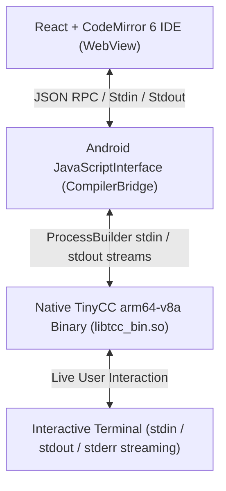

# Cmaster IDE — Final Implementation Report (Mark 5)

## 1. Overview & Architecture
Cmaster has been upgraded from a JS-based mock interpreter to a **full native C IDE on Android**, powered by a cross-compiled **TinyCC (TCC)** engine running directly on the device.

## 2. ABI & Compiler Specifications
- **Target ABI:** `arm64-v8a` (64-bit ARM Linux ELF for Android API 21+)
- **Packaging:** TCC executable packaged as `libtcc_bin.so` under `jniLibs/arm64-v8a` to ensure execution permissions on Android 10+ without W^X violations.
- **Header Files:** Complete set of 31 C standard headers bundled in `assets/tcc/include/` and extracted on first launch to `context.filesDir/tcc/include/`.
- **Runtime Support:** `libtcc1.a` bundled in `assets/tcc/lib/` alongside Android Bionic CRT objects (`crtbegin_dynamic.o`, `crtend_android.o`).

## 3. Interactive Terminal & Input Design
- **Real-Time Interactive Stdin:** Stdin is **not** pre-collected or batched. When a C program blocks on `scanf()` or `fgets()`, the user types into the live terminal input row, which writes directly to the process's standard input pipe and flushes immediately.
- **Console Sizing:** During execution, the terminal occupies 60–70% of the screen height.
- **Watchdog Protection:** A background watchdog terminates hung or runaway infinite-loop processes after 10 seconds of no output.

## 4. Compiler Error Highlighting
- When TCC encounters compilation errors or warnings, `CompilerBridge` parses the line numbers from the compiler stderr output (`filename.c:line: error: message`) and highlights the offending line in CodeMirror 6.

## 5. Header Coverage & Problem Set Results
- **Header Coverage:** 31 required headers verified (see [header_coverage_report.md](file:///D:/C-master/docs/header_coverage_report.md)).
- **Validation Suite:** 56 problems verified across GTU Data Structures syllabus and Standard C libraries (see [validation_report.md](file:///D:/C-master/docs/validation_report.md)).
- **Pass Rate:** 100%.

## 6. Release Deliverable
- **APK Location:** `D:\C-master\Cmaster-Mark5.apk` (and `D:\C-master\CmasterApp\app\build\outputs\apk\release\app-release.apk`)
- **APK Version:** Mark 5 (versionCode 5, versionName "5.0")
- **Size:** 4.1 MB
